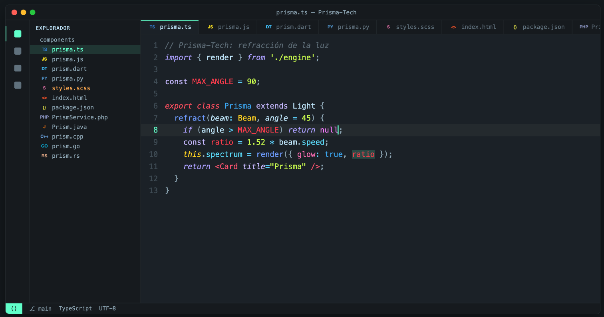
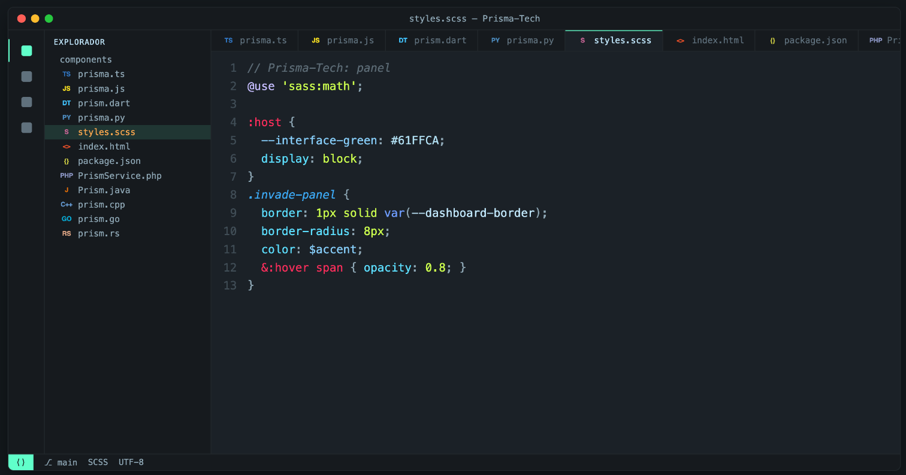
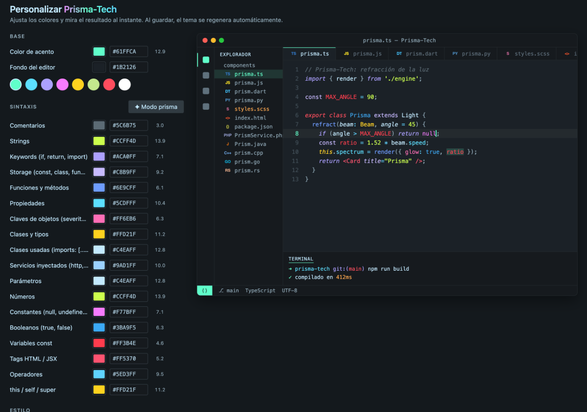

<p align="center">
  
</p>

<h1 align="center">Prisma-Tech</h1>

<p align="center">
  A prismatic dark theme for VS Code, with a visual panel to customize every color live.
</p>

---

**Prisma-Tech** blends the energy of **Aura** (aura green `#61FFCA`, indigo and bright tones) with the structure of **Material**, on a deep petrol-blue background `#1B2126`. Every kind of code gets its own hue of the spectrum: lime green for strings, indigo for keywords, yellow for types, Mexican pink for object keys, sea blue for booleans and class names… and every "white" carries a touch of sky blue.





## Installation

1. Open the **Extensions** view (`Cmd + Shift + X` / `Ctrl + Shift + X`).
2. Search for **Prisma-Tech** and install it.
3. Pick the theme with `Cmd + K` `Cmd + T` (`Ctrl + K` `Ctrl + T`) → **Prisma-Tech**.

## Make it yours

Click the **Prisma-Tech** icon in the activity bar. The controls open in the sidebar and a full-size preview opens in the editor.



- **Every color is editable**: accent, background and 18 syntax colors (strings, keywords, functions, types, parameters, booleans, `const` variables, object keys, injected services…).
- **Live changes, no reload**: VS Code applies each color as you move it. Leave without saving and your saved colors come back.
- **Preview in 12 languages**: TypeScript, JavaScript, Dart, Python, SCSS, HTML, JSON, PHP, Java, C++, Go and Rust, each with its own icon.
- **Click the code**: click any word in the preview and the sidebar jumps to the color that controls it.
- **Contrast at a glance**: every color shows its contrast against the background and warns with ⚠ when it's hard to read.
- **✦ Prism mode**: spreads the syntax colors across the whole spectrum, starting from your accent.
- **Italics and bright text**: toggle italics for comments, keywords and parameters, or boost text contrast.

Panels, sidebar, borders, line numbers and the terminal are derived automatically from the background you choose.

> The customizer panel is currently in Spanish.

### From Settings

You can also configure it in `settings.json`. Only write what you want to change:

```json
{
  "prismaTech.accentColor": "#61FFCA",
  "prismaTech.background": "#1B2126",
  "prismaTech.italicComments": true,
  "prismaTech.italicKeywords": true,
  "prismaTech.italicParameters": true,
  "prismaTech.brightText": false,
  "prismaTech.titleGlow": true,
  "prismaTech.syntax": {
    "keyword": "#ACA0FF",
    "function": "#6E9CFF"
  }
}
```

### Commands

| Command | What it does |
|---|---|
| **Prisma-Tech: Personalizar tema** | Opens the visual panel in a tab |
| **Prisma-Tech: Restablecer colores originales** | Restores the default colors |
| **Prisma-Tech: Abrir ajustes del tema** | Opens the `prismaTech` section in Settings |

## Palette

| Use | Color |
|---|---|
| Editor background | `#1B2126` |
| Accent (cursor, selection, active icons, badges) | `#61FFCA` |
| Text and variables | `#C4EAFF` |
| Strings and numbers | `#CCFF4D` |
| Keywords (`if`, `return`, `import`) | `#ACA0FF` |
| `export` / `class` | `#FF4D5E` |
| Storage (`function`, `interface`) | `#C8B9FF` |
| `const` / `let` / `var` / `constructor` | `#FFA31A` |
| `const` variables | `#FF3B4E` |
| Functions and methods | `#6E9CFF` |
| Properties | `#5CDFFF` |
| Object keys (`severity:`) | `#FF6EB6` |
| Declared class name | `#3BA9F5` |
| Types and interfaces | `#FFD21F` |
| `this` / `self` / `super` | `#FFD21F` |
| Injected services (`http`) | `#9AD1FF` |
| Booleans (`true`, `false`) | `#3BA9F5` |
| Constants (`null`, enums) | `#F77BFF` |
| HTML / JSX tags | `#FF5370` |
| Operators | `#5ED3FF` |
| Comments | `#5C6B75` |

**CSS and SCSS** have their own accents: classes in sea blue, `:root` / `body` / `html` in cherry red, variable declarations in light sky blue and hex colors between sky blue and white.

## Integrations

Prisma-Tech also colors, with the same palette:

- VS Code's modern UI (activity bar, section borders, find widget, checkboxes, buttons).
- The Copilot and agents chat.
- **GitLens**: inline blame, commit, branch and pull request icons, and the commit graph.
- Web views from other extensions that use theme colors (for example, NPM Visual Manager).

## Development

```bash
npm run build
```

Regenerates `themes/prisma-tech-color-theme.json` with the default colors. The generator lives in `src/generator.js`, the panel in `src/customizer.js` and the extension in `src/extension.js`. To try it, open the folder in VS Code and use **Run → Run Without Debugging** (`Ctrl + F5`).

### Publishing a new version

The repository publishes to the Marketplace with GitHub Actions (`.github/workflows/publish.yml`):

1. Bump `version` in `package.json` and note the changes in `CHANGELOG.md`.
2. Commit and tag it: `git tag v0.3.3 && git push origin main --tags`.

The action rebuilds the theme, packages it, publishes it with the `VSCE_PAT` secret and attaches the `.vsix` to the GitHub release.

## License

[MIT](LICENSE)
