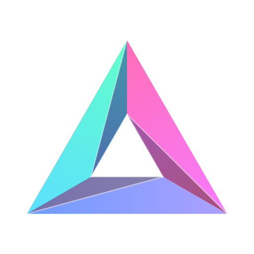

<p align="center">
  
</p>

<h1 align="center">Prisma-Tech</h1>

<p align="center">
  Tema oscuro prismático para VS Code, con un panel visual para personalizar cada color en vivo.
</p>

---

**Prisma-Tech** mezcla la energía de **Aura** (verde `#61FFCA`, índigo y tonos brillantes) con la estructura de **Material**, sobre un fondo azul petróleo `#1B2126`. Cada tipo de código tiene su propio tono del espectro: verde limón para strings, índigo para keywords, amarillo para clases, rosa mexicano para claves de objetos, azul mar para booleanos… y todos los blancos llevan un toque de azul cielo.

## Instalación

1. Abre la vista de **Extensiones** (`Cmd + Shift + X` / `Ctrl + Shift + X`).
2. Busca **Prisma-Tech** e instálalo.
3. Elige el tema con `Cmd + K` `Cmd + T` (`Ctrl + K` `Ctrl + T`) → **Prisma-Tech**.

## Personalízalo a tu gusto

Haz clic en el icono de **Prisma-Tech** en la barra de actividad. En la barra lateral aparecen los controles y, en el editor, una vista previa a tamaño completo.

- **Todos los colores editables**: acento, fondo y 18 colores de sintaxis (strings, keywords, funciones, clases, parámetros, booleanos, variables `const`, claves de objetos, servicios inyectados…).
- **Cambios en vivo, sin recargar**: VS Code aplica cada color mientras lo mueves. Si sales sin guardar, vuelven los colores guardados.
- **Vista previa en 12 lenguajes**: TypeScript, JavaScript, Dart, Python, SCSS, HTML, JSON, PHP, Java, C++, Go y Rust, cada uno con su icono.
- **Clic en el código**: haz clic en cualquier palabra de la vista previa y la barra lateral salta al color que la controla.
- **Contraste a la vista**: cada color muestra su contraste contra el fondo y avisa con ⚠ si se lee mal.
- **✦ Modo prisma**: reparte los colores de sintaxis por todo el espectro a partir de tu acento.
- **Cursivas y texto brillante**: activa o desactiva cursivas en comentarios, keywords y parámetros, o sube el contraste del texto.

El fondo de paneles, barra lateral, bordes, números de línea y terminal se calcula automáticamente a partir del fondo que elijas.

### Desde Ajustes

También puedes configurarlo en `settings.json`. Solo escribe lo que quieras cambiar:

```json
{
  "prismaTech.accentColor": "#61FFCA",
  "prismaTech.background": "#1B2126",
  "prismaTech.italicComments": true,
  "prismaTech.italicKeywords": true,
  "prismaTech.italicParameters": true,
  "prismaTech.brightText": false,
  "prismaTech.titleGlow": true,
  "prismaTech.syntax": {
    "keyword": "#ACA0FF",
    "function": "#6E9CFF"
  }
}
```

### Comandos

| Comando | Qué hace |
|---|---|
| **Prisma-Tech: Personalizar tema** | Abre el panel visual en una pestaña |
| **Prisma-Tech: Restablecer colores originales** | Vuelve a los colores de fábrica |
| **Prisma-Tech: Abrir ajustes del tema** | Abre la sección `prismaTech` en Ajustes |

## Paleta

| Uso | Color |
|---|---|
| Fondo del editor | `#1B2126` |
| Acento (cursor, selección, iconos activos, badges) | `#61FFCA` |
| Texto y variables | `#C4EAFF` |
| Strings y números | `#CCFF4D` |
| Keywords (`if`, `return`, `import`) | `#ACA0FF` |
| `export` / `class` | `#FF4D5E` |
| Storage (`class`, `function`) | `#C8B9FF` |
| `const` / `let` / `var` / `constructor` | `#FFA31A` |
| Variables `const` | `#FF3B4E` |
| Funciones y métodos | `#6E9CFF` |
| Propiedades | `#5CDFFF` |
| Claves de objetos (`severity:`) | `#FF6EB6` |
| Nombre de la clase declarada | `#3BA9F5` |
| Clases y tipos | `#FFD21F` |
| `this` / `self` / `super` | `#FFD21F` |
| Servicios inyectados (`http`) | `#9AD1FF` |
| Booleanos (`true`, `false`) | `#3BA9F5` |
| Constantes (`null`, enums) | `#F77BFF` |
| Tags HTML / JSX | `#FF5370` |
| Operadores | `#5ED3FF` |
| Comentarios | `#5C6B75` |

**CSS y SCSS** tienen sus propios matices: clases en azul mar, `:root` / `body` / `html` en rojo cereza, declaraciones de variables en azul cielo claro y colores hexadecimales entre azul cielo y blanco.

## Integraciones

Prisma-Tech también colorea, con la misma paleta:

- La interfaz moderna de VS Code (barra de actividad, bordes entre secciones, buscador, casillas, botones).
- El chat de Copilot y de los agentes.
- **GitLens**: blame en línea, iconos de commits, ramas y pull requests, y el gráfico de commits.
- Las vistas web de otras extensiones que usan los colores del tema (por ejemplo, NPM Visual Manager).

## Desarrollo

```bash
npm run build
```

Regenera `themes/prisma-tech-color-theme.json` con los colores por defecto. El generador está en `src/generator.js`, el panel en `src/customizer.js` y la extensión en `src/extension.js`. Para probarlo, abre la carpeta en VS Code y usa **Ejecutar → Ejecutar sin depuración** (`Ctrl + F5`).

### Publicar una nueva versión

El repositorio publica en el Marketplace con GitHub Actions (`.github/workflows/publish.yml`):

1. Sube `version` en `package.json` y anota los cambios en `CHANGELOG.md`.
2. Haz commit y crea la etiqueta: `git tag v0.3.1 && git push origin main --tags`.

La acción regenera el tema, empaqueta, publica con el secreto `VSCE_PAT` y adjunta el `.vsix` a la release de GitHub.

## Licencia

[MIT](LICENSE)
